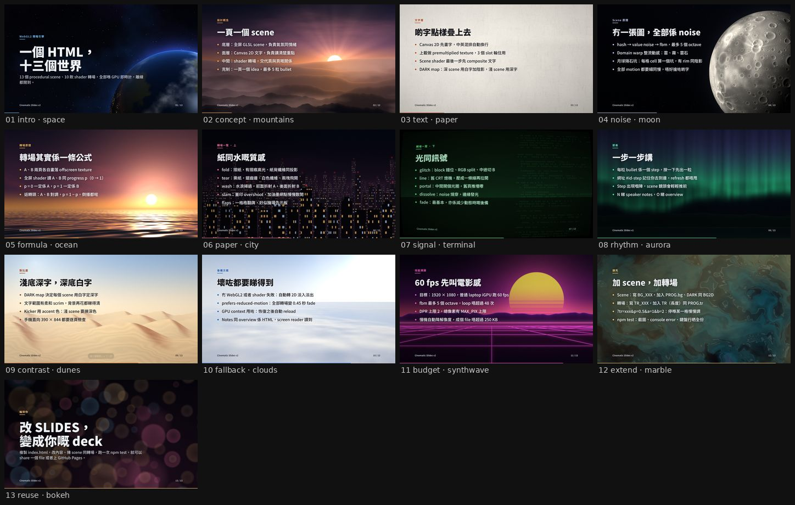
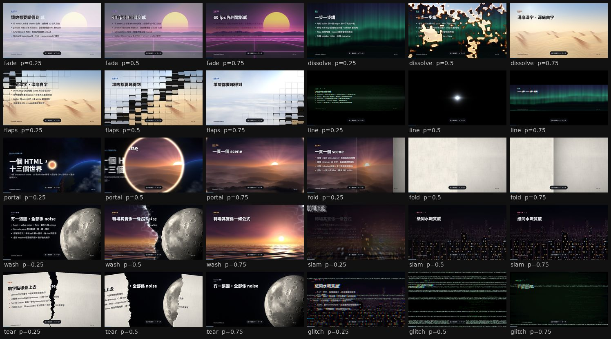

# Cinematic Slides v2

一個 file 搞掂嘅 WebGL2 presentation engine：每頁一個 full-screen procedural GLSL scene，上面一層 Canvas 2D 畫嘅清晰文字，頁同頁之間用 shader transition 接駁。冇 library、冇 build step、冇 CDN、冇外部字型 / 圖片 / 音檔，`index.html`（約 74 KB）雙擊就開得，丟上 GitHub Pages 就有網址。

**▶ 線上睇：<https://alanlee7219.github.io/cinematic-slides/>**



## 點開

- 線上：<https://alanlee7219.github.io/cinematic-slides/>（GitHub Pages）。
- 本機：直接用 Chrome / Safari / Firefox 開 `index.html`。
- 要 WebGL2。冇 WebGL2、或者任何 shader compile / link 失敗，就自動轉 2D fallback（純色背景 + 同一套文字 + fade）。

## 更新網站

網站由 `gh-pages` branch 出，內容同 `main` 一樣。改完 push 去 `main` 之後，再行：

```sh
git push origin main:gh-pages
```

大約 1 分鐘後網站就會更新。

## 操作

| 鍵 | 功能 |
| --- | --- |
| → / Space / Enter / PageDown | 下一步（先逐點 reveal bullet，再換頁） |
| ← / Backspace / PageUp | 上一步（換頁時 transition 倒帶播） |
| Home / End | 第一頁 / 最後一頁 |
| N | Speaker notes |
| O | Overview（全部頁面） |
| F | 全屏 |
| M | 轉場聲效（WebAudio 即場合成，預設關） |
| ? / H | Help |
| Esc | 關閉 panel |
| 手機 | 撳右邊 = 下一步、撳左邊 = 上一步；左右 swipe 換頁 |

網址 hash 係 `#slide-id-step`（例如 `#formula-2`），refresh 都會留喺同一步。Console 有 `window.deck`：`deck.next()`、`deck.prev()`、`deck.go(3, 1)`、`deck.state`、`deck.scenes`、`deck.transitions`、`deck.renderer`。

`prefers-reduced-motion` 開咗嘅話：所有 transition 變 0.45 s fade，鏡頭唔會推。

慢機會自動降解像度：連續約 2 秒低過 40 fps，內部解像度就降 15%（最低 55%）。網址加 `?q=1` 會鎖死全解像度（截圖、測試用）。

## 13 個 scene（`bg`）

| 名 | 內容 | 文字 |
| --- | --- | --- |
| `space` | 星空 + 自轉地球、雲層、夜面城市燈光 | 淺色 |
| `aurora` | 極光簾、山影、湖面倒影 | 淺色 |
| `paper` | 米白紙、纖維、grain、慢慢移動嘅光 | 深色 |
| `mountains` | 日出、6 層 ridgeline、大氣透視、山谷霧、parallax | 淺色 |
| `moon` | 大月球：隕石坑 rim、ejecta rays、terminator 側光、星空 | 淺色 |
| `city` | 3 層深度夜景、窗口開關閃、霧、閃燈飛機橫過 | 淺色 |
| `ocean` | 黃昏海面、多層 wave、太陽反光路、地平線霧、swell | 淺色 |
| `dunes` | 沙丘迎光 / 背光面、風紋、地平線熱浪 | 深色 |
| `clouds` | 雲海上面向前飛、向陽亮邊、近鏡雲絲 | 深色 |
| `synthwave` | 條紋太陽、山影、向你捲嚟嘅 grid、bloom | 淺色 |
| `marble` | Domain-warped 墨水雲石，3 隻 accent 色慢慢流 | 淺色 |
| `terminal` | CRT：barrel curvature、scanline、phosphor glow、flicker | 淺色（綠） |
| `bokeh` | 幾層深度嘅失焦光球慢慢飄 | 淺色 |

深 / 淺由 `DARK` map 決定：深 scene 用淺字 + 柔陰影，淺 scene 用深字 + 白色 halo；shader 亦會喺文字區加一層 scrim，保證對比。

## 10 個 transition（`tr`）

| 名 | 長度 | 效果 |
| --- | --- | --- |
| `fade` | 1.1 s | 柔和交叉淡入 |
| `dissolve` | 1.6 s | Noise 燒穿，邊緣發光 + 火星 |
| `flaps` | 1.9 s | 一格格 tile 斜斜咁翻牌 |
| `line` | 1.3 s | 舊 CRT 熄機：壓成線、縮成點、再拉開 |
| `portal` | 1.5 s | 中間開光圈，A 推向鏡頭 |
| `fold` | 2.1 s | 沿摺痕摺紙：透視、摺痕高光、紙背纖維、投影落 B |
| `wash` | 1.8 s | 水浪掃過：前面折射 A、後面折射 B，泡沫、水珠、caustic |
| `slam` | 1.4 s | 蓋印：B 由大跌落（overshoot 1.06 → 1.0）、鏡頭震、網點油墨慢慢散 |
| `tear` | 2.0 s | 沿鋸齒邊撕開兩塊，白色纖維邊 + 投影，轉住飛走 |
| `glitch` | 1.1 s | Block 錯位、RGB split、scanline jitter、量化 noise band，中途切 B |

全部 transition 喺 `p ∈ [0,1]` 都啱，倒帶（A/B 對調、`p = 1 − p`）一樣睇得。

## 改內容

全部內容喺 `index.html` 最頂嘅 `SLIDES`：

```js
{ id: 'formula', layout: 'list', bg: 'ocean', tr: 'slam', accent: '#ffc46b',
  kicker: 'Transition',
  title: '兩張 texture 一條公式',
  body: ['第一點', '第二點', '第三點'],   // 每點一個 step reveal
  notes: 'Speaker notes（N 鍵）' }
```

- `layout: 'hero'` 用 `sub`（副標題），`'list'` 用 `body`（建議 3–5 點）。
- `bg` 揀 scene，`tr` 係「由呢頁去下一頁」用嘅 transition。
- `id` 用嚟做 hash，只可以用英文、數字、底線。
- `DECK_TITLE` 係左下角嘅名。

## 加一個 scene

1. 寫 `const BG_FOO = TEXT + \`void main(){ vec2 p=camP(); vec3 col=…; o=vec4(withText(col),1.); }\`;`（要星就 `TEXT + STARS + …`）。
2. 喺 `buildPrograms()` 嘅 `bg` 加 `foo: mk(BG_FOO)`。
3. `DARK` 加 `foo: true/false`，`BG2D` 加 fallback 色，CSS 加 `#over .sw.foo` swatch。
4. 喺 `SLIDES` 用 `bg: 'foo'`，跑 test。

## 加一個 transition

1. 寫 `const TR_BAR = \`uniform sampler2D tA,tB; void main(){ … o=vec4(col,1.); }\`;` — `uP=0` 要完全係 A，`uP=1` 要完全係 B。
2. `TR` 加 `bar: { dur: 1.4 }`（1.1–2.2 s），`buildPrograms()` 嘅 `tr` 加 `bar: mk(TR_BAR)`。
3. 用 `?tr=bar&p=0.5&a=1&b=2` 凍結預覽，逐個 `p` 睇。

## GLSL 安全守則

`smoothstep` 一定 `edge0 < edge1`（反方向就 `1.-smoothstep(a,b,x)`）；`pow()` 唔可以負 base；non-uniform branch 入面用 `textureLod(tex,uv,0.)`；loop 用常數上限（≤ 48）；`precision highp float`；每個除法都 guard；fbm ≤ 5 octave。

## Test

```sh
npm install                 # 只係裝 Playwright（devDependency，runtime 唔使）
npx playwright install chromium
node tests/wrap.test.mjs    # CJK 斷行
node tests/shots.mjs        # SwiftShader 截圖 + console / shader error + keyboard walk
npm test                    # 兩樣一齊
```

`tests/shots.mjs` 會：每頁最後一步截 1280×720 同 390×844 @2x、每款 transition 截 `p = 0.25 / 0.5 / 0.75`、任何 console error / page error / shader 錯誤或者 fallback 就 fail、用鍵盤由頭行到尾再驗 hash。截圖同 contact sheet 喺 `docs/screens/`（`SHOTS=0` 就唔寫圖）。Linux 冇 CJK 字型嘅話先裝 `fonts-noto-cjk`，否則截圖會見到豆腐字。



## 重用

想整新 deck：參考 [`skill/SKILL.md`](skill/SKILL.md)，copy `index.html`，改 `SLIDES`，跑 test，deliver 一個 HTML file 或者 GitHub Pages。
